# Glassparency

[](https://www.npmjs.com/package/glassparency)
[](LICENSE)
[](https://ricosuavedev.github.io/glassparency/)

Apple-style **Liquid Glass** for the web: glass that really refracts the page (WebGL, and live SVG filters in
Chromium), squircle rims, specular light, liquid morphing, light/dark themes and an automatic CSS fallback. React
components and hooks, a one-file script for any site, and a `<glass-ui>` element for any framework.

**[See it live →](https://ricosuavedev.github.io/glassparency/)**

| 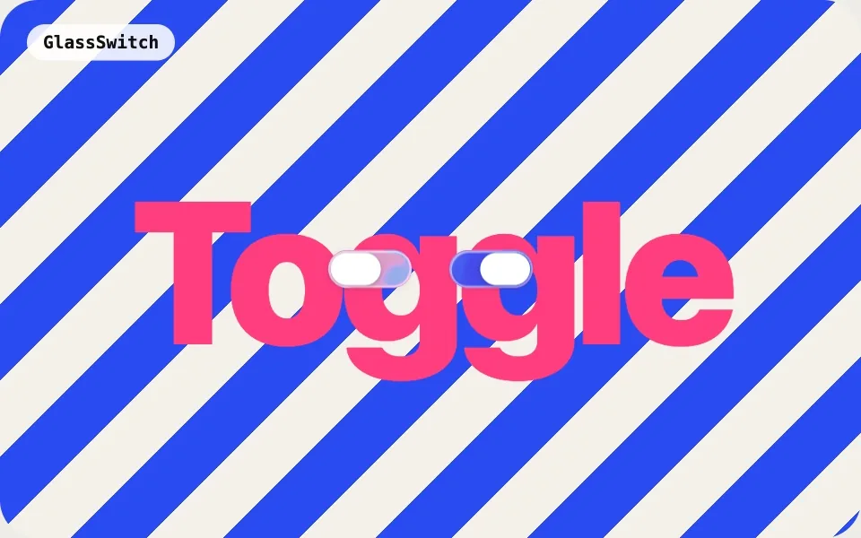 | 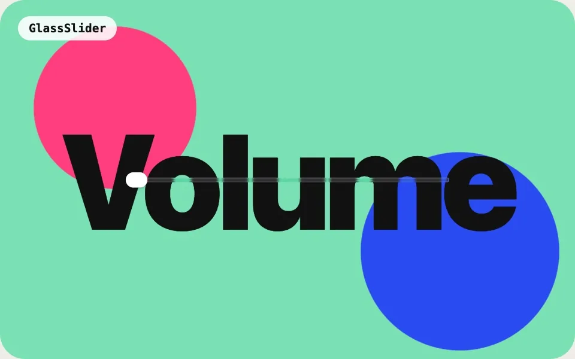 |
|---|---|
| `GlassSwitch`: drag the knob and it turns to glass | `GlassSlider`: a glass knob that bends the track |
| 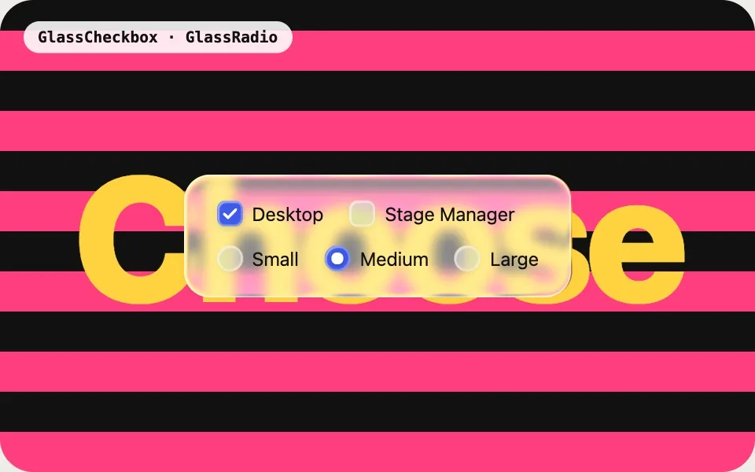 | 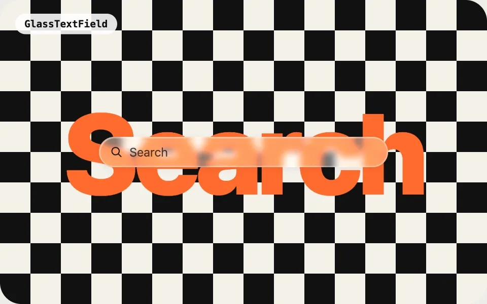 |
| `GlassCheckbox` · `GlassRadio`: squish when pressed | `GlassTextField`: focus glow and a glass clear button |
| 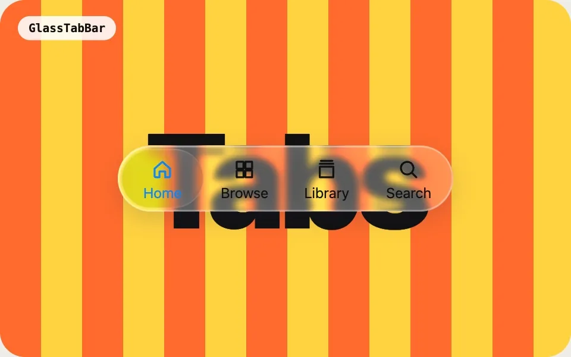 | 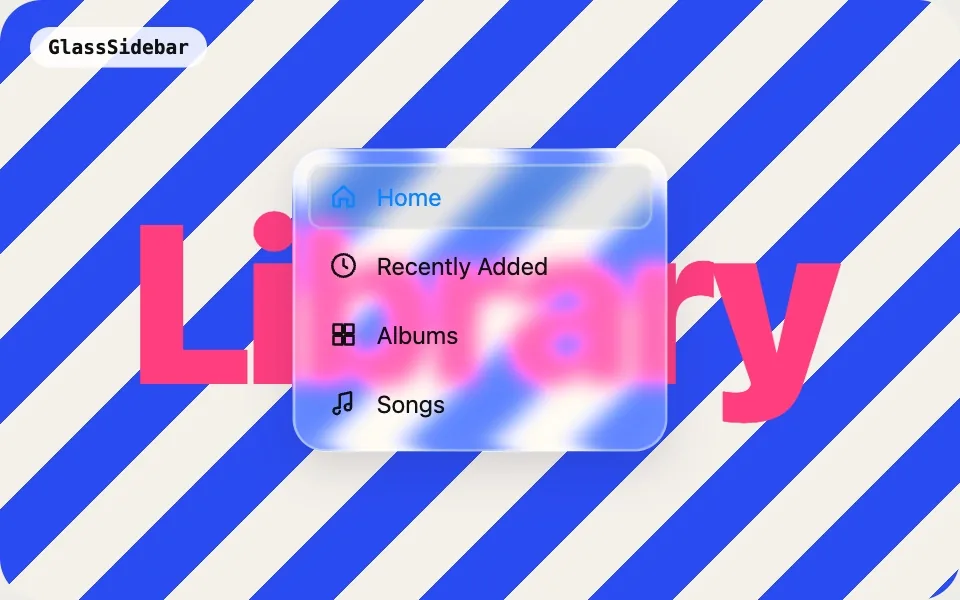 |
| `GlassTabBar`: press and slide, the lens magnifies | `GlassSidebar`: the same lens, vertical |
| 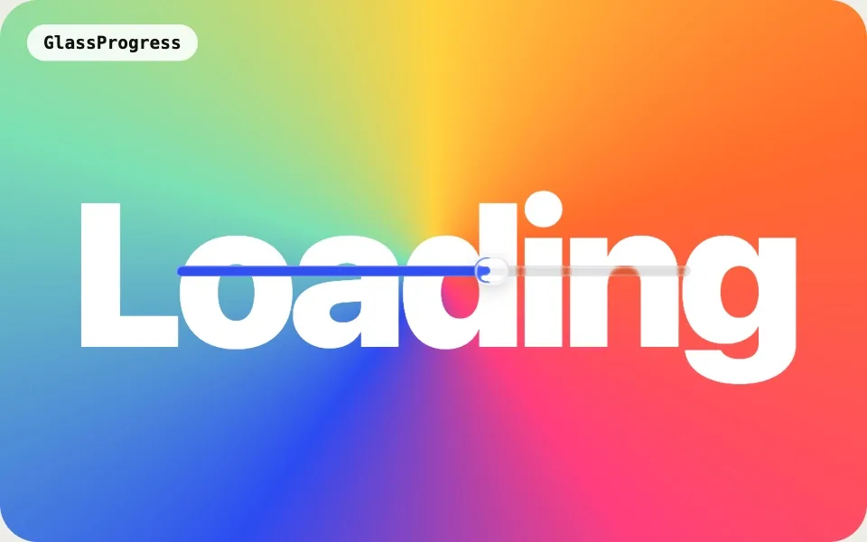 | 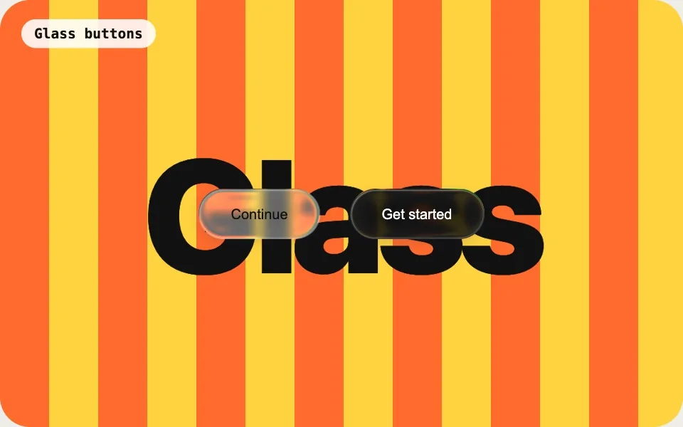 |
| `GlassProgress`: a glass bead, and a liquid drop when busy | Squish & stretch: buttons swell, lean and wobble back |
| 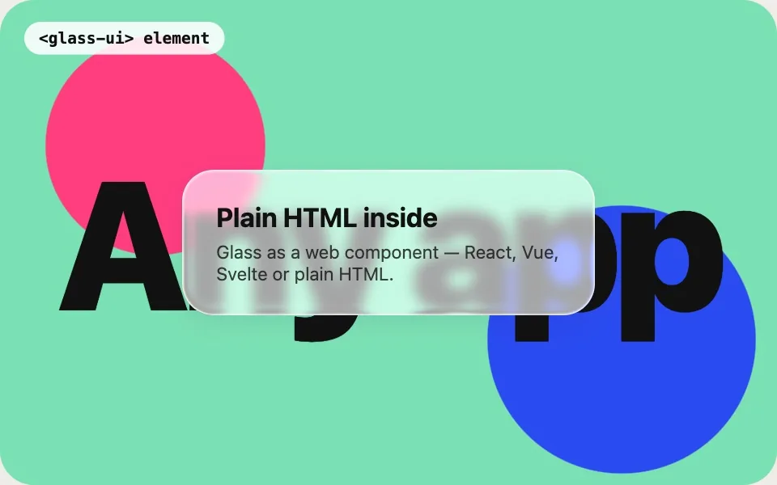 | 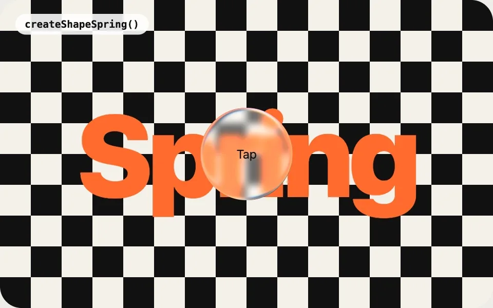 |
| `<glass-ui>`: glass as an HTML element | Shape springs: glass springs between shapes |

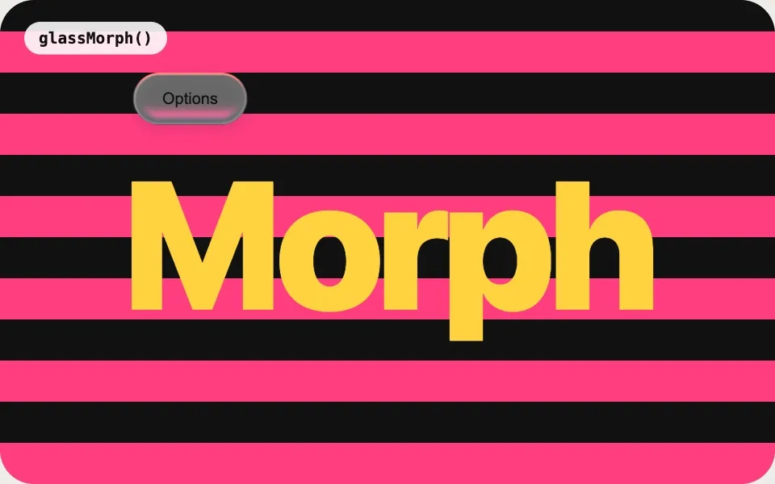

`glassMorph`: the button itself swells into the menu and melts back into it

## Get the library

**npm** (React 19 apps, or any bundler):

```bash
npm install glassparency react react-dom three @react-three/fiber @react-three/drei
```

```jsx
import { GlassProvider, Glass } from 'glassparency';

<GlassProvider>
  <Glass as="button" group="buttonPrimary">Save</Glass>
</GlassProvider>
```

**One `<script>` tag** (plain HTML, WordPress, Shopify, Webflow… — no React needed):

```html
<script src="https://unpkg.com/glassparency/dist/glassparency.standalone.js"></script>

<glass-ui group="card">Any HTML inside</glass-ui>
<button data-glassparency="button">Save</button>
```

**Documentation:** the full guide — every component, the config, how it works — is the
[library README](library/README.md) (the same page as on [npm](https://www.npmjs.com/package/glassparency)).

## What's in this repository

| Folder | What |
|---|---|
| [`library/`](library) | **The source of the npm package.** `npm install && npm run build` there builds it ([how](library/README.md#building-from-source--contributing)) |
| `src/`, `index.html`, `public/` | The [live demo page](https://ricosuavedev.github.io/glassparency/). It installs the published npm package like any other site would; its own looks are the config in `src/main.jsx` |

## Run the demo page

```bash
npm install
npm run dev        # http://localhost:5300
```

Every push to `main` builds the page and publishes it to GitHub Pages (`.github/workflows/deploy.yml`). To show a
newer release of the library: `npm install glassparency@latest`, commit, push.

## Contributing

Issues and pull requests are welcome — see [CONTRIBUTING.md](CONTRIBUTING.md). Every pull request that touches
`library/` is built and smoke-tested automatically (`.github/workflows/library.yml`).
Found a security problem? Please report it privately: [SECURITY.md](SECURITY.md).

## License

[MIT](LICENSE) © RicoSuaveDev. The look is modelled on Apple's Liquid Glass; Glassparency is not affiliated with Apple.
